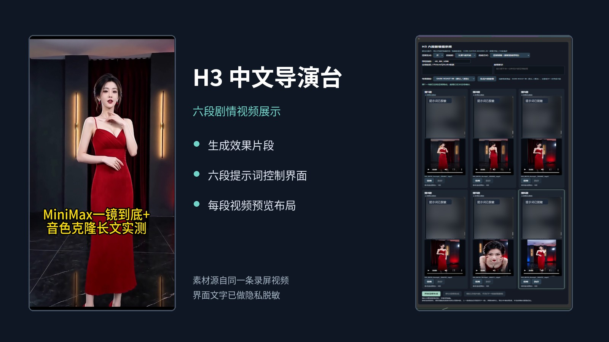
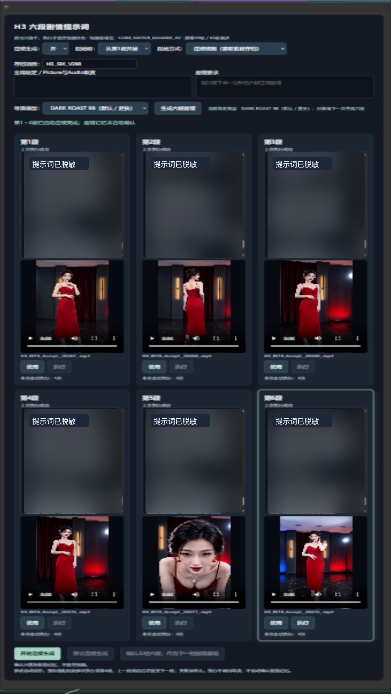

# H3 中文导演台｜ComfyUI MiniMax H3 Chinese Director

**面向 ComfyUI 的 MiniMax-H3 多段连续视频生成工作流与全中文导演台。** 支持六段剧情编辑、连续生成与跨段 AV Latent 接续、Ref2VA 多图参考/FL2VA 首尾帧路线控制、Conditioning PreBake 缓存、自动视频合并。适合希望用中文管理长剧情、人物连续性和分段生成流程的 ComfyUI 用户。

**English:** [H3 Chinese Director — MiniMax H3 six-segment workflow for ComfyUI](README_EN.md) · [GitHub Release v29.4](https://github.com/asd454314633-byte/H3-Chinese-Director/releases/tag/v29.4)

**选择版本：** 当前仓库是 **8197 V29.4 冻结正式线**；需要研究新功能，请前往 [8207 独立公开实验仓库](https://github.com/asd454314633-byte/H3-8207-Experimental)（`v0.1.0-preview`）。两者的工作流、运行状态与 GPU 验收**不能互相代表**。

## 真实录屏展示｜视频效果与六段导演台



以下为从同一条录屏截取的**无声动态预览**。为避免混淆功能，预览只裁切掉原视频底部其他主题的文字标题；视频画面与人物未通过 AI 重绘。


**[▶ 打开 55.7 秒完整视频（MP4，含原声）](https://raw.githubusercontent.com/asd454314633-byte/H3-Chinese-Director/main/assets/showcase/h3-six-segment-demo-github.mp4)**

> 完整 MP4 保留原视频画面和原始字幕。字幕中有关“一镜到底”“音色克隆”等内容是原始素材自身的描述，**不是本仓库六段连续生成、Latent 接续或音色克隆的验收声明**。视频链接指向原始 MP4 文件，部分浏览器会直接下载，并不会自动出现 README 内嵌播放器。

### 六段提示词与视频预览界面

[](assets/showcase/six-segment-panel-redacted.png)

**[查看六段界面原尺寸截图](assets/showcase/six-segment-panel-redacted.png)**

> **真实性边界：** 这些素材展示实际录屏画面及录屏末尾的六段编辑/预览界面。仅凭录屏无法核定 8197 冻结基线来源、六段完整生成回执、AV Latent 接续、自动合并及速度结论；具体验收仍以独立证据和功能矩阵为准。


### 快速查看

- **下载工作流：** [唯一 V29 冻结版 JSON](workflows/current/V29_chinese_director_production_8197.json) · [正式发布包](https://github.com/asd454314633-byte/H3-Chinese-Director/releases/tag/v29.4)
- **安装与使用：** [8197 Windows 安装指南（沿用旧文件名）](docs/INSTALL_WINDOWS_8207.md) · [模型与依赖清单](docs/MODELS.md) · [功能与验收状态](docs/FEATURE_MATRIX.md)
- **核心能力：** 中文控制面板｜六段视频连续生成｜上一段 latent 接续｜自动合并｜参考图/参考视频路线选择｜运行回执与状态安全检查
- **验证边界：** 本机 8197 V29 生产基线已有 GPU 实测；公开版 V29.4 的源码整改通过离线检查，**没有**重新执行完整 GPU 端到端生成。
- **注意：** 本仓库仅发布一套经脱敏的工作流与自研控制层，不包含模型权重、ComfyUI 本体及须独立安装的第三方依赖。

## 不止六段合并：导演台完整能力速览

**10 组核心工程能力 · 多层模式选择器 · 24 项功能/状态矩阵**。这里的“10 组”和“24 项”是**功能分类/矩阵行数，不是全部通过的测试数**。完整选项、执行节点、可用状态和报告链接在 **[完整功能、模式、测试与性能索引](docs/CAPABILITY_CATALOG.md)**。

| 使用者能做什么 | 对应真实模式/机制 | 已知验证边界 |
|---|---|---|
| 一个中文入口控制复杂工作流 | **N159 全中文导演台**；生成、图片、尺寸、采样速度、Ref2VA 后端/注意力、GUIDE、内存策略等选择器 | 已发布自研前端和 181 节点工作流；部分实验开关默认关闭 |
| 管理长剧情并从上次继续 | **六段独立编辑 / 执行 / SUCCESS、连续或独立起点、指定起始段、失败后续跑** | 8197 历史六段真实生成及状态/回执测试 |
| 保持跨段生成链上下文 | **Native AV Latent 接续**，核对前一段身份与有效回执，不只是把 MP4 拼接 | SEG2 使用 SEG1 latent 的历史真实验收；不保证所有镜头零漂移 |
| 切换素材输入 | **文生视频 / 单图 / 首尾帧 FL2VA / 多参考 Ref2VA**；图片、视频与音频参考控制 | 按模型实际支持的分支使用；**不能将 FL2VA 4步误称为四图 Ref2VA** |
| **参考音色与声音克隆** | **独立参考音频 1/2/3 + 参考视频音轨**、说话人/角色与 `<Audio N>` 对应关系、音色片段检查与重编号；为新对白提供音色参考 | **Ref2VA + 指定 8步参考分支**的源码能力；2–15 秒单条、启用参考合计 ≤15 秒；**用户确认音色克隆已实测并长期稳定使用**（`OWNER_CONFIRMED_LONG_TERM_USE`）；公开包未提供逐音色脱敏 E2E 样例，不能凭此虚构测试次数 |
| 切换模型与速度 | **默认、画质优先、高速平衡**；Ref2VA 原版 / **FastH3 VSA 4步** / **PDD 8步**；独立的 **FastH3 V2 8步** 候选位 | 路线与默认开关不同；FastH3 V2 8步默认关闭，性能优劣需同条件实测 |
| 选择注意力技术 | **FastH3 VSA / SLA / Sage Attention / INT8 Attention / Core BlockSparse** 五路**分列** | SLA 只有路线位，BlockSparse 属隔离实验；**不是五路全部生产通过** |
| 节省重复编码及内存 | **Conditioning PreBake** 缓存、Host Warm、TE 选择性卸载、VAE 前释放、PDD 兼容 | 26 项 PreBake 历史离线回归 PASS；仍有显著内存压力 |
| 自动交付视频并阻断串段 | **六段成功门禁 → 自动合并**；group / prompt / latent SHA 资格校验 | 历史合并 996 帧 / 41.5 秒；不是任意时长/分辨率通用承诺 |
| 高级修复与引导 | **已验收 Clean Rebase + 官方单帧 Guide**；另有坏段检测、扩时、二次采样、窗口修复、多时间点 GUIDE、Pose/Depth、V2V/RV2V | 2026-10-09 六段中第4段 Guide frame0 与五处接缝通过；其余部分分支默认旁路、待单独验收 |
| 可检查、可复现与二次开发 | 自研节点源码、Windows 安装说明、模型/第三方归属、离线测试、性能数据 | 发布包不含模型权重及私人数据；新环境完整 GPU E2E 未重新测试 |

### 测试数据和性能：写清“测了什么”

| 核查层级 | 已记录的结果 | 不能误写成 |
|---|---|---|
| **8197 历史真实六段视频** | **132.926 / 92.423 / 90.368 / 87.255 / 91.070 / 90.277 秒**；合并 **41.5 秒 / 996 帧** | “稳定 90 秒/段”或 v29.4 新一轮 GPU 复测 |
| **v29.4 公开发布门禁** | **33 PASS、0 FAIL、2 HOLD**；核心测试 **13/13 + 7/7 + 17/17 PASS**；隔离安装 **9/9 PASS** | 33 次视频生成成功 |
| **V28 历史全量兼容测试** | **285 项执行；16 failures / 56 errors / 14 skipped**，与该次报告基线一致 | 285/285 全绿 |
| **基准与资源** | **120 条性能指标记录**（12 条人工核对核心行、108 条报告抽取）；采样峰值 **22,016 MiB**；最低可用 RAM **5.94 GiB** | 120 次独立 GPU 成功或低资源需求 |


**额外经实际生产验收的亮点：** Stable8 与 PDD8 两路 8 秒/8 步视频（111.186s / 110.052s）；音色克隆参考已由作者明确确认长期稳定使用；六段第4段的 Clean Rebase + 单帧 Guide frame0、五处视频接缝及自动合并均有生产验收记录。更多案例见 [完整验收目录](docs/CAPABILITY_CATALOG.md#32-clean-rebase--guide多时间点实验与已验收的单帧必须分开)。
**完整核对**：[功能模式与逐项证据](docs/CAPABILITY_CATALOG.md) · [24 项功能矩阵](docs/FEATURE_MATRIX.md) · [真实性能表](benchmarks/SUMMARY.md) · [v29.4 门禁报告](docs/acceptance/FINAL_GATE_REPORT.md) · [作者原创与第三方归属](AUTHOR_CONTRIBUTIONS.md)。


面向 **MiniMax-H3 视频生成** 的**全中文集中控制导演台**：一个把「六段剧情编辑 → 连续视频生成调度 → 上一段 AV Latent 接续 → Conditioning PreBake 缓存 → 自动六段合并 → 工作流安全门控与运行回执校验 → 显存/内存生命周期工程化」串成一条生产链的完整控制层与自研节点实现。

> **本仓库只发布一套工作流**：`workflows/current/V29_chinese_director_production_8197.json`（8197 冻结生产版）。
> 本仓库**不分发**历代旧工作流、8207 实验工作流与历史工程档案；8197 历史工程资料仍由作者本机归档。8207 已在[独立实验仓库](https://github.com/asd454314633-byte/H3-8207-Experimental)单独发布**实验预览版**，不属于本仓库的正式生产发布。

> 本项目是**本地作者主导的原创工程**：从 V16 一路演进到 V29 的中文导演台体系、自研 ComfyUI 节点、前端控制层、缓存/回执安全机制与内存生命周期优化，均由本仓库作者设计、实现、调试与验收。
> **MiniMax-H3 模型、ComfyUI 引擎、第三方 PDD/VSA/注意力优化节点不属于本作者原创**，其归属见 [`docs/UPSTREAM_ATTRIBUTION.md`](docs/UPSTREAM_ATTRIBUTION.md) 与 [`THIRD_PARTY_NOTICES.md`](THIRD_PARTY_NOTICES.md)。

> ⚠️ **原创性边界（不要读成"全部原创"）**：本仓库**含有第三方材料与第三方派生件**，且**有两项依赖不在包内、必须自行安装**：
> 1. 唯一工作流里的 **SDPose 多人姿态子图**是 `Comfy-Org/workflow_templates`（MIT）官方 blueprint 的**派生子图**（不是完全原创），已钉版本并列明修改 → 见 `THIRD_PARTY_NOTICES.md` §4；
> 2. **MiniMax 官方 H3 提示词 Skill** 三份文件是**官方原版**，许可未取得授权（`LICENSE_HOLD`），**已从公开包移除**，运行时需你自行提供副本 → 见 §3.1；
> 3. **ComfyUI-H3-AudioRefine**（Adudeguyman, MIT）是**外部依赖**，公开包不含 `vendor/`，需另行安装 → 见 §3.1。
> 因此本仓库不使用"所有子图完全原创""不包含任何第三方内容"这类表述。

---

## 一、这不是什么，是什么

- **不是**模型发布：本仓库**不含任何模型权重**（`.safetensors` / `.ckpt` / `.pt` / `.gguf` 等一律不上传），只给出原作者下载链接、版本、文件名、安装目录与核验方式，见 [`docs/MODELS.md`](docs/MODELS.md)。
- **不是**ComfyUI 发行版：不搬运 ComfyUI 框架、Python venv、Torch 安装目录或第三方节点的整包源码。
- **不是**历史档案库：不打包历代工作流与历史报告，避免历史 JSON/日志再次夹带个人创作内容。
- **是**一套可导入、可二次开发、可复现的**唯一 V29 冻结生产工作流 + 自研节点 + 前端 + 安装/验证脚本 + 结构性测试**。

## 二、本地作者的原创贡献（首屏摘要）

| # | 原创能力 | 归属 | 实现位置 | 证据 |
|---|---|---|---|---|
| 1 | 全中文集中控制导演台（单入口 `N159 H3OperationSelector`） | 独立自研 | `custom_nodes/local_author/**/h3_workflow_helpers/` | 工作流 181 节点；`docs/FEATURE_MATRIX.md` |
| 2 | 六段剧情编辑与状态管理（`H3SixDirectorState` + `six_prompt_state`） | 独立自研 | `custom_nodes/local_author/**/h3_workflow_helpers/`、`H3_Prompt_Sidecar/web/` | 六段真实生成 SUCCESS |
| 3 | 连续视频生成调度（continuous / start_index / start_mode） | 独立自研 | 同上 + `H3_ChineseDirectorUI/js/chinese_director.js` | 六段连续验收 |
| 4 | 上一段 AV Latent 接续（`LTXVSeparateAVLatent` → `LTXVConcatAVLatent` 编排） | 独创工作流编排 | `workflows/current/V29_chinese_director_production_8197.json` 子图 `New Subgraph连续-封装` | SEG2 真实续接 SEG1 latent，H3 重读 0 字节 |
| 5 | Conditioning PreBake 缓存、失效与恢复（`h3_conditioning_prebake`） | 独立自研 | `custom_nodes/local_author/**/h3_conditioning_prebake/` | 离线回归 26 项 PASS |
| 6 | 自动六段视频合并（`H3_Prompt_Sidecar` / ManualChainMerge 路线） | 独立自研 | `custom_nodes/local_author/**/H3_Prompt_Sidecar/` | 合并 41.5 秒 / 996 帧 |
| 7 | 工作流安全门控与运行回执校验（group/prompt/latent receipt 拒绝旧回执） | 独立自研 | `h3_conditioning_prebake`、工作流 `extra.h3_*` 契约 | 改段文字→后续旧视频回执失效 |
| 8 | 显存/内存生命周期工程化（Adaptive Host Warm、`H3SelectiveTEUnload`、`H3PartialDiffusionEvictBeforeVAE`、PDD 308 patch 兼容） | 独立自研（基于上游 H3 运行时做二次开发） | `h3_adaptive_host_warm_inplace/`、`h3_selective_te_unload/`、`h3_partial_diffusion_evict/` | 三条真实路径验收通过 |
| 9 | 模型/采样/参考素材多路线管理（Generation / Image / Ref2va / Speed / Fl2v / Size / Operation 选择器矩阵） | 独创工作流编排 | 工作流内 `H3*Selector` 节点群 | 五路注意力分列 |
| 10 | 自研前端控制层（中文导演台 UI、六段面板、开关持久化、GUIDE 权威归一） | 独立自研 | `custom_nodes/local_author/**/H3_ChineseDirectorUI/js/`、各包 `web/*.js` | 1.52.7 切走/切回双态保持 PASS |

完整逐项证据（用途 → 设计特点 → 确切源码路径 → 与上游差异 → 版本 → 测试 → 归属类型 → 核实状态）见 [`AUTHOR_CONTRIBUTIONS.md`](AUTHOR_CONTRIBUTIONS.md)。

## 三、快速开始

> **当前公开版本：** [v29.4](https://github.com/asd454314633-byte/H3-Chinese-Director/releases/tag/v29.4)。安装前请检查官方依赖许可；仅发布 8197 生产线的公开副本，**不会更改作者本机冻结生产环境**。

1. 安装 ComfyUI（官方版）与 Python/PyTorch/CUDA 环境 → [`docs/INSTALL_WINDOWS_8207.md`](docs/INSTALL_WINDOWS_8207.md)
2. 按 [`docs/UPSTREAM_ATTRIBUTION.md`](docs/UPSTREAM_ATTRIBUTION.md) 安装所需第三方自定义节点（精确到仓库与版本）
3. 按 [`docs/MODELS.md`](docs/MODELS.md) 自行下载模型权重到对应目录
4. 安装本仓库自研节点：把 `custom_nodes/local_author/8197_production_line/*` 复制到你的 `ComfyUI/custom_nodes/`（公开包内只有这一条生产线）
5. 导入**唯一**公开发布的工作流 `workflows/current/V29_chinese_director_production_8197.json`，只操作画布上的「H3 全中文傻瓜导演台」唯一入口
6. 无需模型的离线测试：`python scripts/verify/verify_workflow_structure.py` 与 `python tests/test_workflow_structure.py`

### 3.1 两项不在包内的依赖（不装会在用到时才明确报错，不会静默降级）

| 依赖 | 上游 | 许可 | 安装方式 | 缺失时的表现 |
|---|---|---|---|---|
| MiniMax 官方 H3 提示词 Skill | `MiniMax-AI/MiniMax-H3` → `skills/h3-prompt-writing/` | **`LICENSE_HOLD`**（GitHub API `license == null`；HF MiniMax Community License Agreement，含地域/商业限制） | 自行获取官方副本后：`python scripts/setup/install_minimax_official_skill.py --source <副本目录>`，或设置环境变量 `H3_MINIMAX_OFFICIAL_SKILL_DIR=<副本目录>` | 只在**真正解析官方 guide 时**抛 `H3OfficialGuideMissing`（含来源/许可说明/安装命令）。`H3_V28_Director` 包本身可正常导入 |
| ComfyUI-H3-AudioRefine | `Adudeguyman/ComfyUI-H3-AudioRefine` @ `fd5a8dfe8b4c636b1877abd07d11ebc985eddbed` | **MIT** © 2026 Adudeguyman | `python scripts/setup/install_h3_audio_refine.py --source <副本目录>`（安装器只支持 `--source` 与 `--dest`，不支持自动下载） | 抛 `H3AudioRefineMissing`（含上游地址/许可/commit/`git clone` 命令）。**不返回桩实现、不静默跳过音频功能** |

两个安装器都**默认不联网、不自动下载**；`--verify` 只做校验不写盘。**注意：默认安装目标在仓库副本内部**，不会自动进入你实际使用的 ComfyUI。若已把节点复制到 ComfyUI，请显式使用 `--dest` 指向实际节点目录（MiniMax：`ComfyUI/custom_nodes/H3_V28_Director/skills/official-minimax-h3-prompt`；AudioRefine：`ComfyUI/custom_nodes/H3_AudioUpgrade/vendor`），或按官方指南配置 `H3_MINIMAX_OFFICIAL_SKILL_DIR` / `H3_AUDIO_REFINE_DIR`。完整可执行示例见安装文档。

> **8197 与 8207 的验收不互相代表**：8197 是冻结生产线的验收结果；8207 是作者本机的独立运行/实验线，其源码与验收档案**不在本公开包内**。本仓库**只发布 8197 冻结生产工作流与 8197 生产线源码**。详见 [`docs/INSTALL_WINDOWS_8207.md`](docs/INSTALL_WINDOWS_8207.md)。

## 四、仓库结构

```
workflows/current/      唯一公开发布的工作流：V29_chinese_director_production_8197.json（已脱敏）
custom_nodes/local_author/  本地作者自研节点源码与前端（8197 冻结生产线）
scripts/setup|verify|sanitize/  安装、验证、脱敏脚本
config/examples/        配置模板（模型路径映射、UI 冻结清单等，运行回执已占位符化）
docs/                   架构、功能矩阵、模型、上游归属、安装、安全与隐私、发布说明
benchmarks/             真实测试耗时表 runs.csv + SUMMARY.md（证据指向生产侧本机归档）
tests/ + fixtures/synthetic/  不含私有素材的结构性测试与非工作流夹具
manifests/nodes.csv     自研/第三方节点归属与许可台账
```

公开包内**没有** `workflows/history/`、`history/`、历史文件清单与排除清单；也**没有**可直接导入的第二套工作流（含合成测试夹具，见 `fixtures/synthetic/README.md`）。

## 五、隐私与脱敏

本仓库工作流、源码与配置文件均为 `SANITIZED_PUBLIC_COPY`；`assets/showcase/` 为经作者授权且遮挡私人提示词的演示素材例外：已做**内容级**清洗（不是改文件名、不是加 `.gitignore`、不是删一张图），逐项移除：

- 除 `assets/showcase/` 经授权且脱敏的四份展示素材外，其他用户图片/视频/音频/参考素材及其文件名、base64、data URI、缩略图与预览缓存全部移除
- 全部个人创作提示词（六段剧情、角色设定、台词、正负提示词、续写缓存、测试输入）
- 全部本机个人化路径与身份（账户路径、用户名、设备标识、局域网地址、分享链接）
- 全部密钥/凭据（token、PAT、API Key、Cookie、Authorization、数据库连接串）
- 全部用户运行状态（上次采样输入、prompt_id、group_id、receipt、latent 来源、最新选图、UI 会话）

**保留**：节点类型、连线拓扑、参数名、经验证的通用默认值、真正属于功能逻辑的通用系统模板与编译规则、上游公开 URL、软件版本、`127.0.0.1` 示例。
**未篡改**：真实耗时、日期、错误原因与验收结论——结论不因脱敏而改写；但**逐节点的原始运行回执**（prompt_id、pid、时间戳、素材文件名）不公开。
**逐节点核验**：唯一 V29 工作流的 181 个顶层节点 + 2 个内嵌子图的 15 个节点，全部按类型/连线/参数逐项做过隐私审计，断言见 `tests/test_workflow_structure.py` 与 `tests/test_public_release_scope.py`。
详见 [`docs/SECURITY_AND_PRIVACY.md`](docs/SECURITY_AND_PRIVACY.md)。

## 六、测试与性能

- 真实六段生成（8197 冻结生产）：`132.926 / 92.423 / 90.368 / 87.255 / 91.070 / 90.277` 秒；自动合并 41.5 秒，996 帧 / 24fps / 608×1056
- GPU 采样峰值 22016 MiB；可用 RAM 最低 5.94 GiB；Commit 采样峰值 95.05 GiB
- 单次真实值、重复实测、理论估算、未验证结论在 [`benchmarks/runs.csv`](benchmarks/runs.csv) 中**分开标注**，不把一次测试写成稳定平均，不隐藏失败与 HOLD
- `runs.csv` 的 `evidence_file` 列以 `LOCAL_ARCHIVE:` 前缀指向生产侧本机归档（公开包内不含这些档案，数字与其出处保持原样，不做二次修饰）

## 七、许可

- 本仓库作者原创部分：**MIT License**（见 [`LICENSE`](LICENSE)）。MIT 的覆盖范围在 `LICENSE` 中逐条列出。
- **不**对本仓库里的任何第三方原版文件授 MIT：
  - MiniMax 官方 H3 提示词 Skill → `LICENSE_HOLD`，已从公开包移除、改为外部依赖；
  - SDPose 多人姿态子图 → 随唯一工作流分发，但它是 `Comfy-Org/workflow_templates`（**MIT**）的**派生件**，按上游 MIT 附带修改声明，**不宣称完全原创**；
  - ComfyUI-H3-AudioRefine → 上游 MIT © 2026 Adudeguyman，外部安装，保留其自有署名与许可。
- ComfyUI 宿主是 GPL-3.0，但 GPL **不自动延伸**到独立的第三方仓库（如上述 MIT 的 `workflow_templates`）。
  本项目对上游运行时的 import / monkey-patch / 覆写属于**运行时耦合**，不构成对其源码的复制或派生。
- 第三方依赖与模型：各自许可见 [`THIRD_PARTY_NOTICES.md`](THIRD_PARTY_NOTICES.md) 与 [`docs/UPSTREAM_ATTRIBUTION.md`](docs/UPSTREAM_ATTRIBUTION.md)。
  未查实许可的项目一律标 `LICENSE_HOLD`，**不做无依据的法律定论**，清单见 [`REMAINING_HOLD.md`](docs/acceptance/REMAINING_HOLD.md)。
- 本仓库**不含**模型权重，用户需自行按模型原作者的许可与地域/商业限制下载。

## 八、状态

`PUBLISHED_PASS` / `STAGING_READY_NOT_PUBLISHED` / `HOLD` 的最终判定写在 [`docs/RELEASE_NOTES.md`](docs/RELEASE_NOTES.md) 末尾，并附发布 commit 与克隆复核结果。

English version: [`README_EN.md`](README_EN.md)
